<div align="center">

# CapooDesk 咖波桌宠

**一群会走路、会撒娇、会叠罗汉的咖波，住在你的 Windows 任务栏上。**

Bugcat Capoo desktop pet for Windows · 126 Capoos, all unlocked · no gacha, no account

[](https://github.com/lanternian/CapooDesk/releases/latest)


[](https://github.com/lanternian/CapooDesk/stargazers)

<a href="docs/media/demo.mp4">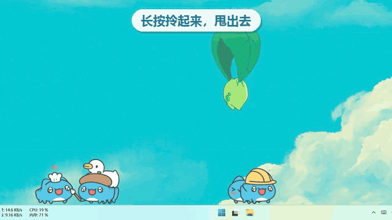</a>

▶️ [完整演示视频（1 分钟）](docs/media/demo.mp4) &nbsp;·&nbsp; ⬇️ [下载 Windows 版](https://github.com/lanternian/CapooDesk/releases/latest) &nbsp;·&nbsp; ⭐ 喜欢的话点个 Star

</div>

## 咖波们会做什么

<table>
  <tr>
    <td width="50%" align="center">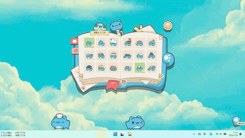<br><b>魔法书召唤</b><br>126 只全部解锁，点一下格子就来</td>
    <td width="50%" align="center">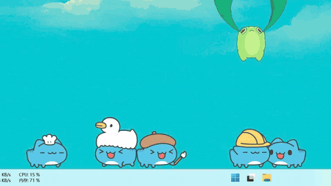<br><b>摸摸</b><br>鼠标在它身上来回蹭，冒爱心</td>
  </tr>
  <tr>
    <td align="center">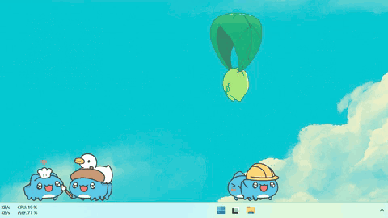<br><b>拎起来、甩出去</b><br>长按拖动，松手时带着速度就飞出去打滚</td>
    <td align="center">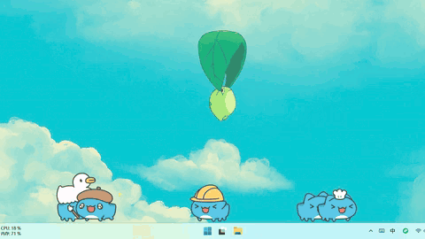<br><b>叠罗汉</b><br>扔到别的咖波头上，最多 12 层，下面的驮着走</td>
  </tr>
  <tr>
    <td align="center">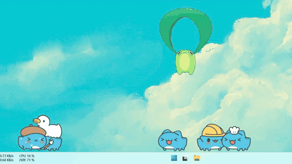<br><b>撞晕</b><br>扔过去砸中别的咖波，它会晕一会儿</td>
    <td align="center">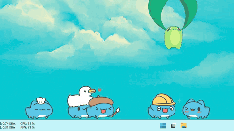<br><b>戳一下</b><br>单击它，各种表情反应</td>
  </tr>
  <tr>
    <td align="center">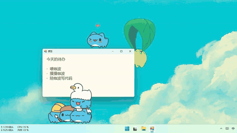<br><b>站在窗口上</b><br>窗口顶边也是地面，拖动窗口它跟着走</td>
    <td align="center">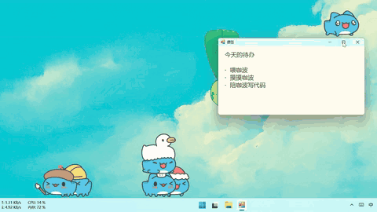<br><b>关掉窗口就掉下来</b><br>落回任务栏，继续溜达</td>
  </tr>
  <tr>
    <td align="center">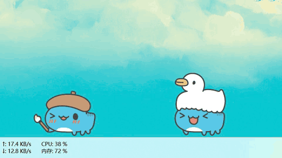<br><b>喂食</b><br>饿了头上冒碗，点一下或用右键菜单喂它</td>
    <td align="center">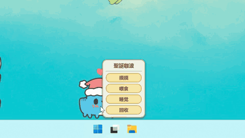<br><b>睡觉</b><br>你离开电脑它就犯困，夜里更爱打盹；右键也能哄它睡</td>
  </tr>
</table>

## 特点

- **全部解锁**：126 只咖波直接召唤，没有扭蛋、合成、成就和账号。
- **偏陪伴**：会饿、会拉便便、会犯困，点头上的气泡照顾它；不理它也不会怎样。
- **认得你的桌面**：站在任务栏和窗口顶边上，窗口移动时跟着走，窗口关掉就掉下来。
- **不打扰**：只有咖波和魔法书能点，别处的点击直接穿透到桌面；有程序全屏（游戏、视频）时自动隐藏，没人理时降到 30 帧。
- **开箱即用**：单个 exe，不用安装，自带运行时和全部素材。

## 下载

1. 到 [Releases](https://github.com/lanternian/CapooDesk/releases/latest) 下载最新的 `CapooDesk-*-windows-x64.zip`（Windows 10 / 11，64 位）。
2. 解压，双击 `CapooDesk.exe`。
3. exe 没有数字签名，第一次运行时 SmartScreen 可能会拦截：点「更多信息」→「仍要运行」。

退出：托盘图标右键 →「退出」。

## 怎么玩

| 操作 | 效果 |
|---|---|
| 单击咖波 | 戳它一下（各种表情反应） |
| 鼠标在咖波身上来回蹭 | 摸摸，冒爱心 |
| 长按拖动 | 拎起来；松手时带速度就是扔出去，撞到别的咖波会把它撞晕 |
| 扔到别的咖波头上 | 叠罗汉，最多 12 层，下面的会驮着走 |
| 点头上的碗 / 扫帚气泡 | 喂食 / 扫便便（不理它也没关系，过一会儿自己就好了） |
| 右键咖波 | 小菜单：摸摸、喂食、睡觉/叫醒、回收 |
| 书本按钮（可拖动） | 打开魔法书（左边两个书签：咖波图鉴 / 设置） |
| 图鉴里点一格 | 召唤这只咖波；鼠标停在格子上会冒出它的名字 |
| 图鉴里的绿色格子 | 这只咖波正在桌面上；格子右下角的小按钮回收一只，丝带旁的垃圾桶回收全部 |
| 托盘图标 | 左键开魔法书；右键菜单：召唤、全部回收、隐藏咖波、隐藏魔法书、置顶、退出 |

咖波会站在任务栏上，也会站在其他窗口的顶边上，窗口移动时跟着走，关掉或最小化窗口就会掉下来。
你离开电脑一段时间（默认 10 分钟）它们会睡着，回来后陆续醒来；夜里（23:00-7:00）更爱打盹。
有程序全屏（游戏、视频）时自动隐藏，并把帧率降到最低。

## 魔法书

<div align="center">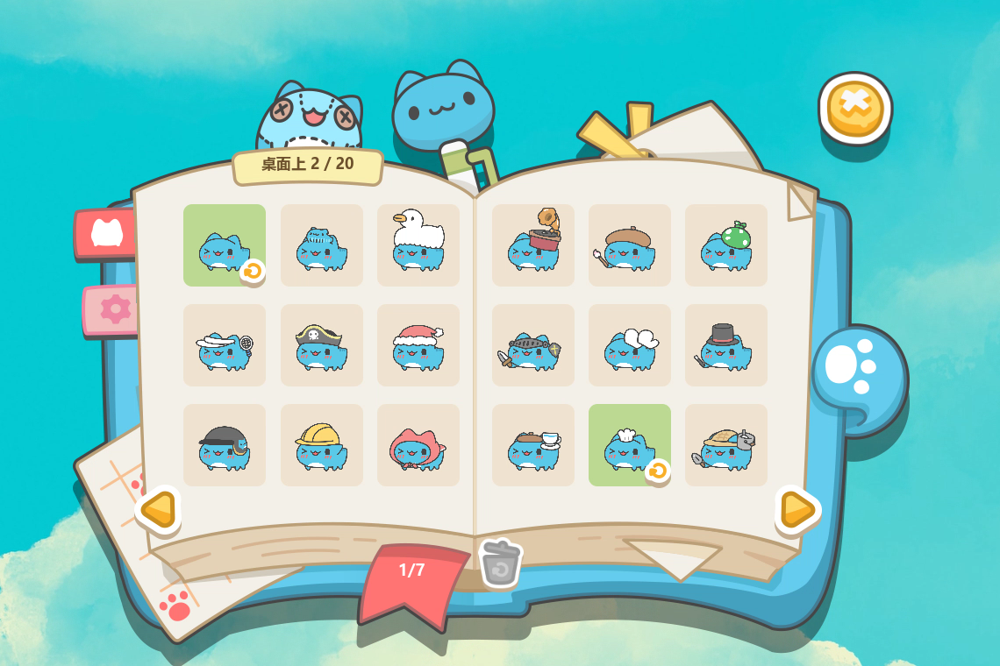</div>

图鉴一页 18 只，共 7 页；绿色格子是已经在桌面上的咖波。

设置在齿轮书签里。左页用 ◀ ▶ 调：音效、大小、数量上限、帧率上限、透明方式（逐像素 / 颜色键，显卡不支持逐像素透明时切换）、饿/便便频率、离开多久后睡。
右页勾选：会睡觉、夜里多打盹（23:00-7:00）、站在窗口顶上、叠罗汉、全屏时隐藏、低功耗、总在最前、书本按钮、开机启动（仅导出的 exe）；
下面的「怎么玩」是操作说明，「退出」关闭程序。

「隐藏魔法书」（托盘菜单）和设置里的「书本按钮」是同一个开关：隐藏后仍可以从托盘打开魔法书。

设置和桌面上的咖波保存在 `%APPDATA%\CapooDesk\settings.json`，删掉即可恢复默认。

## 开发

需要带 spine-godot 4.1 模块的 Godot 4.2.1 mono 编辑器（`D:\app\Godot\godot-editor-windows-mono\godot4.exe`）。

官方素材不在 `main` 分支里，而是单独放在 `assets` 分支。克隆后先取回素材，再打开一次 Godot 编辑器让它导入：

```bash
sh tools/fetch_assets.sh                          # 把 assets 分支的 assets/ 解压到工作区（已被 .gitignore 忽略）
dotnet build
godot4 --path .                                   # 运行
godot4 --path . -- --test --selftest              # 自动化交互测试（不会动真实鼠标）
godot4 --headless --path . --export-release "CapooDesk" ../build/CapooDesk/CapooDesk.exe
```

详细文档见 [docs/](docs/README.md)。

## 版权

素材（Spine 动画、UI 图片、音效、角色和动作数据）来自官方 CapooPals，版权归原权利人所有，仅供个人学习使用，请勿商用或再分发。

---

<div align="center">

如果咖波让你的桌面可爱了一点，欢迎点个 ⭐ Star，或者分享给同样喜欢咖波的朋友。

</div>
